L'Essence — Luxury Perfume E-Commerce 🌟
if you find it useful don't forget to give 🌟 

  <a href="https://com2-65de5.web.app">Live Demo</a> ·
  <a href="https://github.com/abdouh071/perfume-ecommerce-store-dashboard">GitHub Repository</a> ·
  <a href="https://github.com/abdouh071/perfume-ecommerce-store-dashboard/issues">Report an Issue</a>

  
  
  
  
  

L'Essence is a modern luxury perfume e-commerce platform designed for the Algerian market. It combines a premium shopping experience with a powerful administration dashboard, multilingual support, and integrations with local delivery providers.

Built with React, Vite, Tailwind CSS, and Firebase, the platform features a Liquid Glass-inspired interface, order management, dynamic store customization, and delivery operations.

Live Demo: https://com2-65de5.web.app

✨ Key Features

🛍️ Customer Experience

- Liquid Glass-inspired UI: Glassmorphism, smooth animations, and a dynamic Ken Burns hero carousel.
- Multilingual support: English, French, and Arabic, including right-to-left (RTL) layouts.
- Product catalog: Browse perfumes, product details, fragrance notes, categories, and featured products.
- Smart checkout: Calculate shipping rates based on the customer's Wilaya.
- StopDesk pickup points: Dynamically retrieve available pickup locations where supported.
- Order tracking: Allow customers to follow their orders.
- Responsive design: A modern shopping interface designed for different screen sizes.

🖼️ Storefront Screenshots

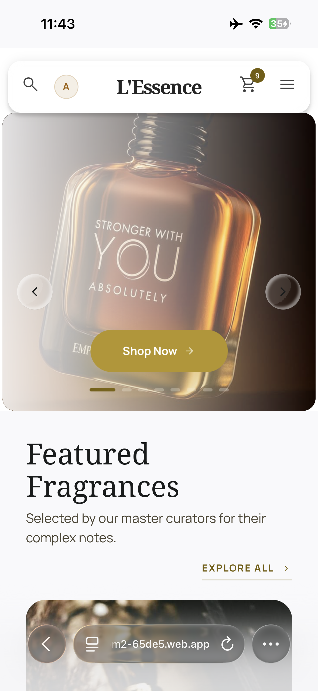

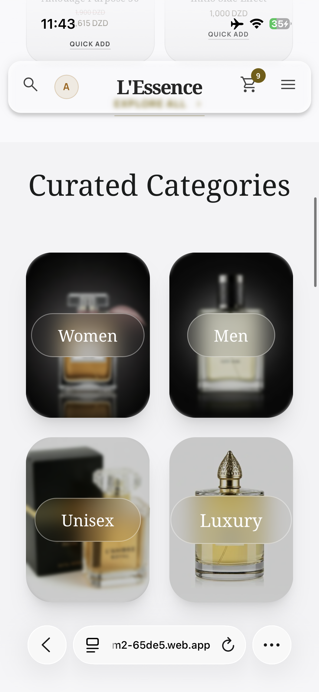

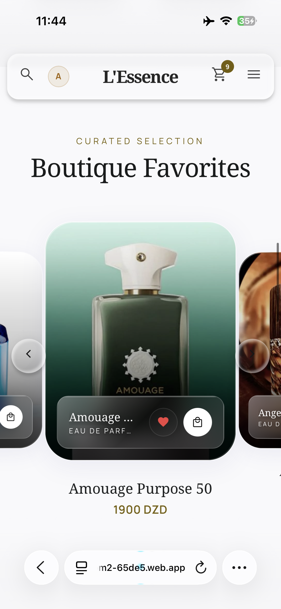

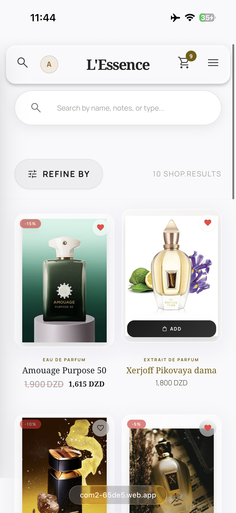

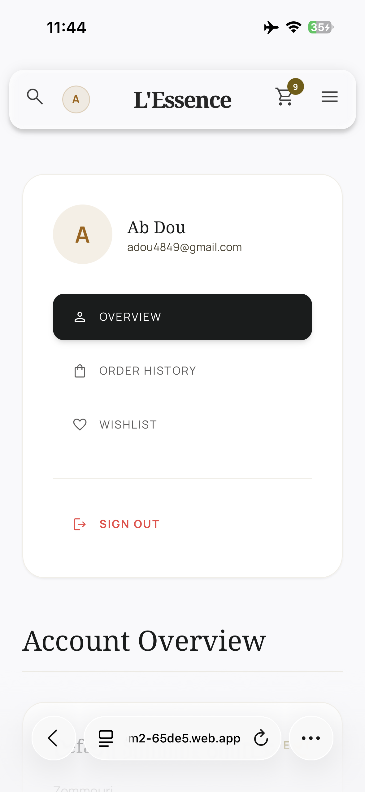

🚚 Algerian Delivery Integrations

Designed around the needs of Algerian e-commerce businesses.

- Integrations with delivery providers such as Yalidine, Maystro, and Ecotrack.
- Shipping rate retrieval and delivery configuration.
- Order submission to supported courier services.
- Shipping label generation and printing through the administration dashboard.
- Webhook-based order status updates where supported.

🛡️ Backend Architecture

- Firebase Cloud Functions: Proxy shipping API requests through server-side functions.
- Credential protection: Keep private courier API credentials on the server rather than exposing them in frontend code.
- Cloud Firestore: Store application data and synchronize supported updates.
- Firebase Authentication: Handle user authentication.
- Automated webhooks: Process courier status updates and synchronize order information.

«Security depends on proper Firebase Security Rules, server-side authorization, and webhook validation. A Cloud Functions proxy alone does not guarantee application security.»

📊 Administration Dashboard

- Product management: Create, update, and delete products, including stock, pricing, fragrance notes, and images.
- Order management: Review orders and manage order processing.
- Courier operations: Dispatch orders, retrieve shipping labels, and manage supported delivery integrations.
- Store customization: Update the hero carousel, categories, and featured products through the dashboard.
- Shipping configuration: Configure supported couriers and synchronize shipping rates.
- Team management: Manage team-related settings available in the application.

📸 Dashboard Screenshots

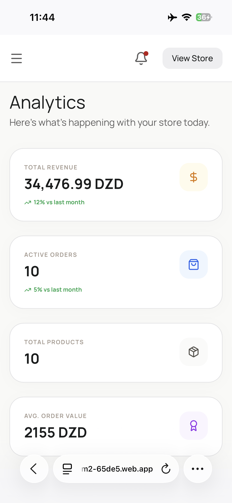

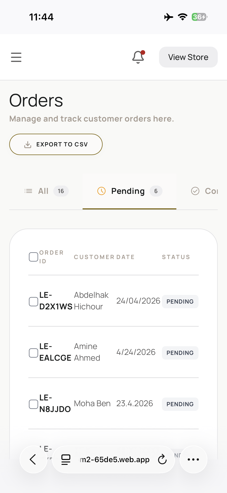

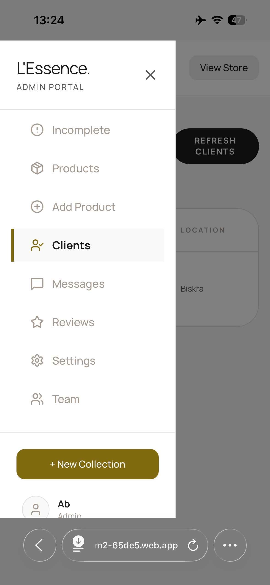

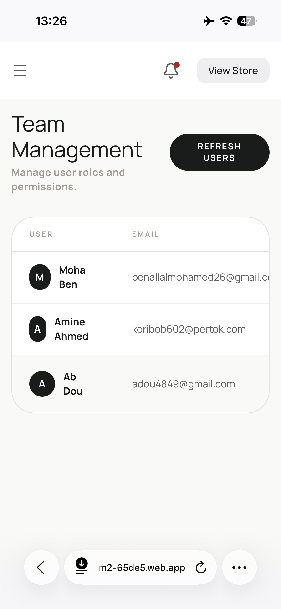

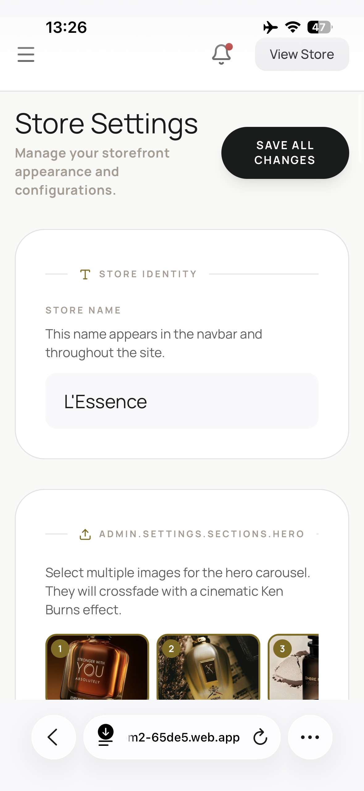

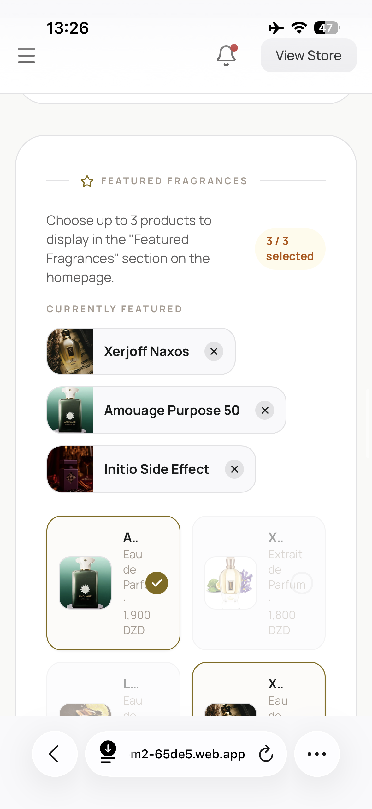

🛠️ Technology Stack

Technology| Purpose
React.js| Frontend user interface
Vite| Development server and build tooling
Tailwind CSS| Styling and responsive layouts
React Context API| Application state management
Firebase Authentication| User authentication
Cloud Firestore| Cloud database
Firebase Cloud Functions| Server-side logic and API proxy
Firebase Hosting| Application hosting
ImgBB API| Image hosting and uploads
Framer Motion| UI animations
Lucide React| Interface icons
Google Material Symbols| Additional interface icons

🚀 Getting Started

Follow these steps to run your own development instance.

Prerequisites

- Node.js 18 or later, subject to the project's actual dependency requirements.
- npm
- Git
- A Firebase project
- Firebase CLI, if you need to deploy Cloud Functions

1. Clone the Repository

git clone https://github.com/abdouh071/perfume-ecommerce-store-dashboard.git

cd perfume-ecommerce-store-dashboard

2. Install Dependencies

npm install

3. Configure Firebase

Create your own Firebase project and enable the services required by the application.

Depending on the features you use, these may include:

- Firebase Authentication
- Cloud Firestore
- Firebase Cloud Functions
- Firebase Hosting

Create a ".env" file in the project root using the environment variable names expected by the source code:

VITE_FIREBASE_API_KEY=your_firebase_api_key
VITE_FIREBASE_AUTH_DOMAIN=your_firebase_auth_domain
VITE_FIREBASE_PROJECT_ID=your_firebase_project_id
VITE_FIREBASE_STORAGE_BUCKET=your_firebase_storage_bucket
VITE_FIREBASE_MESSAGING_SENDER_ID=your_messaging_sender_id
VITE_FIREBASE_APP_ID=your_firebase_app_id
VITE_IMGBB_API_KEY=your_imgbb_api_key

Important:

- Verify that these variable names match the application's actual configuration.
- Vite exposes "VITE_" variables in the client-side bundle. Do not put private server credentials in these variables.
- Configure Firebase Security Rules and authentication permissions for your own project.
- Configure private courier credentials and other server-only settings separately for Cloud Functions.
- Do not commit real secrets or private API tokens to GitHub.

4. Run the Development Server

npm run dev

Open the local URL displayed in your terminal.

5. Configure Cloud Functions

If you want to use the delivery integrations, install the Cloud Functions dependencies:

cd cloud-functions-source
npm install

Authenticate with Firebase and select your own project:

firebase login
firebase use --add

Configure the server-side environment values and courier credentials required by the implementation.

Then deploy the functions:

firebase deploy --only functions

Deployment requirements and billing depend on the Firebase services and features you use.

For additional information, see the
.

🔐 Production Checklist

Before deploying your own version:

- Configure and test Firestore Security Rules.
- Restrict administrative actions to authorized users.
- Store private courier credentials on the server.
- Validate orders and webhook requests.
- Configure your own Firebase project and deployment targets.
- Test checkout, shipping calculations, order creation, and tracking.
- Review each delivery provider's API requirements and terms.

🤝 Contributing

Contributions, bug reports, and feature suggestions are welcome!

1. Fork the repository.
2. Create a branch for your changes.
3. Commit your improvements.
4. Open a pull request describing your contribution.

Use "GitHub Issues" (https://github.com/abdouh071/perfume-ecommerce-store-dashboard/issues) to report bugs or suggest features.

📄 License

This project is licensed under the MIT License.

You are free to:

- Use the application for personal or commercial purposes.
- Modify and customize the source code.
- Reuse the code in other applications and projects.
- Distribute original or modified versions.
- Sell copies of the application or products derived from it.
- Use the project as a foundation for commercial services, templates, or SaaS products.

The main condition is that the original copyright notice and the MIT License text must be included in copies or substantial portions of the software.

See the ""LICENSE"" (LICENSE) file for the full license text.

👨‍💻 Author

Abdelhak Hichour

- GitHub: "@abdouh071" (https://github.com/abdouh071)

⭐ Support the Project

If you find L'Essence useful, consider giving the repository a ⭐ on GitHub.

Stars help other developers discover the project and encourage further improvements.

---

Built with ❤️ for the Algerian e-commerce ecosystem.
